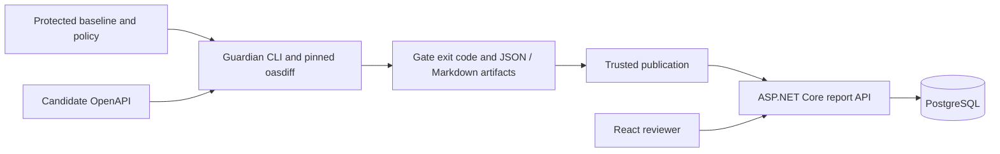

# API Contract Guardian

API Contract Guardian validates local OpenAPI documents and detects backward compatibility changes with a pinned diff engine. A .NET API stores versioned CI reports in PostgreSQL for review in a browser.



## Quick start

Install the .NET 10.0.201 SDK specified by `global.json`. Run from the repository root.

```text
dotnet restore Guardian.slnx --locked-mode
dotnet build Guardian.slnx -c Release --no-restore -warnaserror
dotnet format Guardian.slnx --verify-no-changes --no-restore
dotnet test Guardian.slnx -c Release --no-build --logger trx --results-directory artifacts/tests
dotnet publish src/Guardian.Cli -c Release --no-build -o artifacts/guardian
dotnet artifacts/guardian/guardian.dll --help
dotnet artifacts/guardian/guardian.dll version
```

Run the CLI smoke tests and OpenAPI probes in PowerShell with `tar` available. The installer verifies the archive checksum before extraction. To use an existing release archive on an offline machine, pass `-ArchivePath` to the installer.

```powershell
& ./scripts/verify-cli.ps1
$engine = & ./scripts/install-oasdiff.ps1
& ./scripts/probe-oasdiff.ps1 -Engine $engine
& ./scripts/verify-contracts.ps1 -Engine $engine
& ./scripts/verify-policy.ps1 -Engine $engine
```

Set `GUARDIAN_OASDIFF_PATH` to the absolute path of the installed engine. Then run Guardian against a spec or a pair of specs.

```powershell
$env:GUARDIAN_OASDIFF_PATH = $engine
dotnet artifacts/guardian/guardian.dll validate examples/base.yaml
dotnet artifacts/guardian/guardian.dll compare --base examples/base.yaml --candidate examples/breaking.yaml
```

Add `--policy .guardian.yml --out artifacts/reports` to write JSON and Markdown reports. The v1 policy uses a severity threshold from `compatibility.fail_on` (for example, `[WARN]` blocks WARN and ERR). `compatibility.fail_on_unknown` controls whether an unknown finding blocks the comparison. Optional `rules` set an effective severity for known rule IDs before evaluation. The built-in policy blocks ERR and UNKNOWN.

Both report formats include the verdict, input hashes when available, and engine and Guardian versions. CI provides baseline and candidate commits and its pipeline ID. See the [JSON report schema](schemas/report-v1.schema.json).

### OpenAPI support

| Input | Supported scope |
|---|---|
| Versions | OpenAPI 3.0.x and 3.1.x. Compare two specs from the same minor version. |
| Files | A single UTF-8 JSON or YAML document per spec. Limits are 5 MiB, 64 levels and 2,048 references. |
| References and dialect | Internal JSON Pointers and the default dialect. External references, dynamic schema references and reusable `components.pathItems` are outside the supported scope. |
| YAML | Unique scalar keys and plain YAML. Aliases, merge keys and explicit tags are rejected. |

Use `--input-root <dir>` on `validate` or `compare` to confine input files to a trusted local directory. Relative paths are resolved from the current working directory. With confinement enabled, Guardian checks the explicit policy as well as specs and rejects symbolic links and reparse points in the input paths. See the [policy reference](docs/policy-reference.md) and [threat model](docs/threat-model.md).

Compare writes one JSON object to stdout with the engine version and sorted findings. Findings include the rule, severity, endpoint, source coordinates when available, and a stable fingerprint. The fingerprint excludes the message and source coordinates. Invalid input and engine failures write a diagnostic to stderr.

| Exit code | Meaning |
|---|---|
| `0` | Success |
| `1` | Invalid command-line arguments |
| `2` | Compare found a breaking or unknown change |
| `3` | Invalid or unsupported spec |
| `4` | Diff engine or internal error |
| `5` | Invalid or missing explicit policy |
| `6` | Report publication failed |

The help and version commands use codes `0` and `1`. With `--out`, validation, engine and policy failures produce an `INDETERMINATE` report with a diagnostic.

## Local report viewer

Install Docker with Compose v2. Copy `.env.example` to `.env` and set the three secrets. Use a database password, a reviewer password of at least 12 characters, and a randomly generated report token of 64 hex characters. Compose restricts the viewer to loopback and stores PostgreSQL data and session keys in named volumes.

```powershell
docker compose build api web
docker compose up -d
curl.exe --fail http://127.0.0.1:5186/health/ready
```

The migration service initializes a FlowForge project and its first maintainer. Open `http://127.0.0.1:5186` and sign in with `reviewer@example.invalid` and the password from `.env`. The viewer lists reports in project history and displays findings and provenance. You can seed both reports from the FlowForge GitLab demonstration after publishing the local CLI in Quick start.

```powershell
$env:GUARDIAN_REPORT_TOKEN = (Get-Content .env | ConvertFrom-StringData).GUARDIAN_REPORT_TOKEN
$project = '6bc296f9-06f9-468c-9b77-e605ca9103a1'
foreach ($outcome in 'breaking', 'compatible') {
    dotnet artifacts/guardian/guardian.dll publish `
        --report "tests/Guardian.Api.IntegrationTests/Fixtures/flowforge-$outcome.json" `
        --api-url http://127.0.0.1:5186 --project $project
    if ($LASTEXITCODE -ne 0) { break }
}
Remove-Item Env:GUARDIAN_REPORT_TOKEN
```

`publish` accepts JSON report v1 up to 10 MiB. It uses HTTPS or a loopback HTTP URL and reads the write token from the environment. On success it prints the analysis ID and verdict and exits `0`, including when the stored verdict is `FAIL`. An exact replay returns the same analysis ID. An incompatible payload for the same analysis key returns HTTP `409`. The bootstrap token expires after one day.

For the local HTTPS profile and settings for independent GitHub and GitLab evidence verification, see [Demo HTTPS and CI evidence](docs/ci-evidence.md).

Maintainers can list, create and revoke write tokens through `GET` and `POST /api/v1/projects/{projectId}/tokens` and `DELETE /api/v1/projects/{projectId}/tokens/{tokenId}`. Creation accepts `{"expires_in_days": 1}` with a range of 1–30 days and returns the secret once. Mutations require the reviewer session cookie and the `X-CSRF-TOKEN` header obtained from `GET /api/v1/auth/csrf`. `GET /api/v1/projects/{projectId}/audit-events` returns up to 100 recent events. The session, project membership and audit controls are covered by the PostgreSQL integration suite.

See the [Report Store OpenAPI contract](openapi/guardian-http-v1.yaml) for routes, request shapes and authorization.

To run the database tests, set `GUARDIAN_TEST_POSTGRES` to a disposable PostgreSQL 17 connection with permission to create databases, then run `dotnet test tests/Guardian.Api.IntegrationTests -c Release`. For browser checks, seed both demo reports, export `GUARDIAN_DEMO_PASSWORD` from `.env`, then run `npm ci`, `npx playwright install chromium` and `npm run test:e2e` from `web`.

## FlowForge contract probe

Use an isolated FlowForge checkout of commit `05d7e7c6830474cc17dbf0d1758da290fa8497c7`. From its `backend` directory, use `uv sync --frozen --python 3.12`, then run `uv run --frozen python <Guardian>/scripts/export-flowforge.py <output-directory>`.

The script exports OpenAPI twice, checks that the bytes match and that each reference resolves inside the document, then writes a second contract with an integer `RunOutput.run_id`. Run `verify-contracts.ps1 -Engine $engine -FlowForgeContracts <output-directory>` from Guardian to check the unchanged and breaking comparisons through the published CLI.

## CI

[GitHub](https://github.com/hung-it/Api_Contract_Guardian) is the source repository. Push the same verification commit to [GitLab](https://gitlab.com/hung-it/api_contract_guardian), then confirm that the pipeline ran on the same full SHA. The `verify` job uses a fresh Linux checkout and publishes the CLI, xUnit results, engine probes and Guardian comparison results as artifacts.

The protected `main` branch publishes the Linux AMD64 CLI image on changes to the build inputs. The detached merge-request demo runs `api_contract_guard` using a registry digest. The job reads the baseline and policy from one fetched commit of its protected target and reads the candidate from the pipeline commit. Open both reports in the job's `reports/` artifact to inspect the verdict, source commits and input hashes.

On protected `main` pushes, `publish_reports` starts a temporary API and PostgreSQL service for the job. It takes a `FAIL` report from the `verify` artifacts, checks exit `6` during API unavailability, then publishes twice and verifies a single stored analysis. The original gate retains its own verdict and artifacts.

GitLab requires a successful pipeline for merge. The project-level CI/CD configuration points to a reviewed GitHub commit. The gate runs the script bundled in the pinned image and loads the baseline and policy from the protected target. Update the project setting to the new reviewed full SHA when releasing a CI configuration change. The [threat model](docs/threat-model.md) describes what this setup covers.

### Troubleshooting

| Symptom | Check |
|---|---|
| `compare` exits `2` | Read `report.md` for the affected operation, effective severity and applied policy. Fix the incompatibility or review an intentional policy change on the protected target. |
| `compare` exits `3`, `4` or `5` | Check diagnostic codes in `report.json`. Check that both specs exist at the documented SHA, the pinned engine matches its checksum, and the trusted policy parses. |
| `publish` exits `6` | Check `/health/ready`, the report's schema version, and the token's scope and expiry. Retry an interrupted upload with the same report bytes. For HTTP `409`, compare provenance and content with the original analysis. |
| Readiness check fails | Inspect `docker compose logs migrate api` and check `/health/ready`. The migration service initializes the project before the API starts. |

## Benchmark

Use Linux AMD64 with the SDK from `global.json`, PowerShell 7 and GNU `time`. Build the CLI with the Quick start commands, then run the checked-in harness from the repository root.

```powershell
$engine = & ./scripts/install-oasdiff.ps1
$sha = git rev-parse HEAD
& ./scripts/benchmark-cli.ps1 -Engine $engine -SourceSha $sha
```

The harness compares generated pairs of 10, 100 and 500 operations. Each pair contains one response type change. It records process elapsed time through report generation, peak RSS from GNU `time`, input hashes and environment details. Median and nearest-rank p95 use 30 measured runs per workload after five warmups. Results go to `artifacts/benchmark/`. Release evidence and benchmark results are available from [GitHub Releases](https://github.com/hung-it/Api_Contract_Guardian/releases).

## License

Guardian is released under the [MIT License](LICENSE). The CLI distribution carries the [YamlDotNet notice](licenses/YamlDotNet.txt), and the pinned oasdiff distribution retains its upstream license.
